<div align="center">

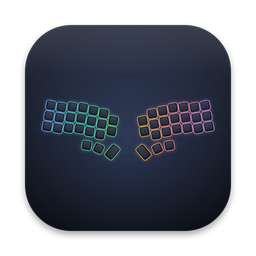

# Corne Studio

**A desktop keymap editor for the Corne split keyboard family, v1 to v4.**<br/>
Plug in, click a key, pick a new one, done. Changes go straight to the keyboard over USB. No compiling, no flashing, no website.


<a href="docs/corne-studio-promo.mp4">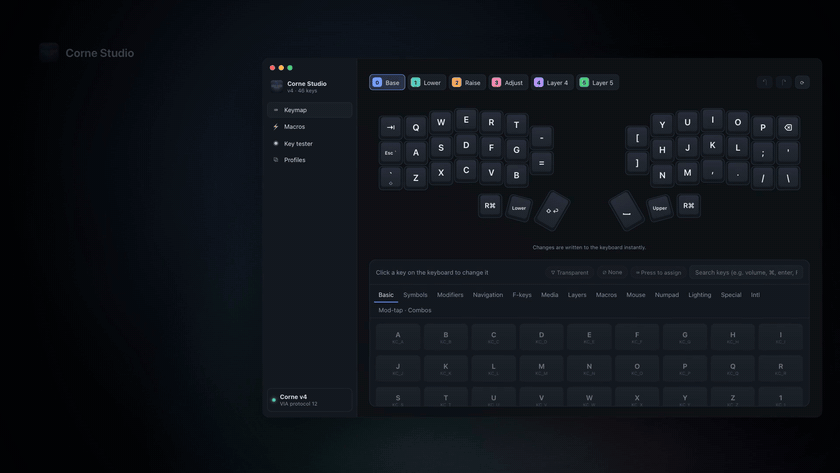</a>

**▶ [Watch the 35-second promo, with sound](docs/corne-studio-promo.mp4)**

</div>

## Why

The [Yushakobo Corne V4 Cherry](https://shop.yushakobo.jp/en/products/8961) ships with VIA-enabled QMK firmware and is normally configured through the Remap website. Corne Studio is a dedicated desktop app for the same job:

- It **recognises which Corne you plugged in** (v1–v3, v4.0, v4.1, v4 mini and popular clones) and draws that board as it really is: column stagger, the v4 inner keys, and the angled thumb cluster with the 1.5u key.
- It's a real desktop app for macOS and Linux, so there's no bookmark to forget.
- It saves snapshots of your setups and backs up the original keymap automatically.

## Features

### Keymap editor
Six layers with their own colours (double-click a tab to rename it). Click any key and choose from a searchable, categorised palette, or press **⌨ Press to assign** and hit a key. Every change is written to the keyboard instantly, with **⌘Z / ⇧⌘Z** undo/redo (**Ctrl+Z / Ctrl+Shift+Z** on Linux). Modifier legends follow your OS: `⌃ ⌥ ⇧ ⌘` on macOS, `Ctrl Alt ⇧ Super` on Linux. Hover a key to see its QMK name and matrix position.

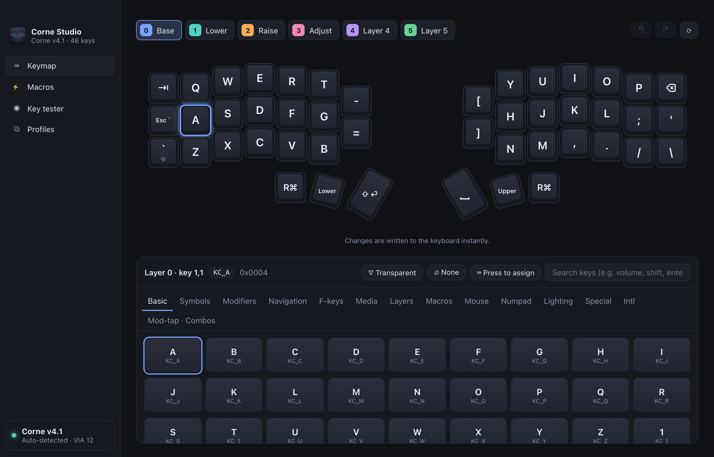

### Layer overlay
Hold a layer key (Lower, Raise, any `MO`/`LT`/`TT`) and a frosted-glass heads-up display of that layer appears over whatever you're doing, even full-screen apps. Let go and it's gone. It never takes focus, so your typing keeps going to the app you're in. Lower + Upper shows Adjust, keys pressed right now are highlighted, and transparent keys show what they fall through to.

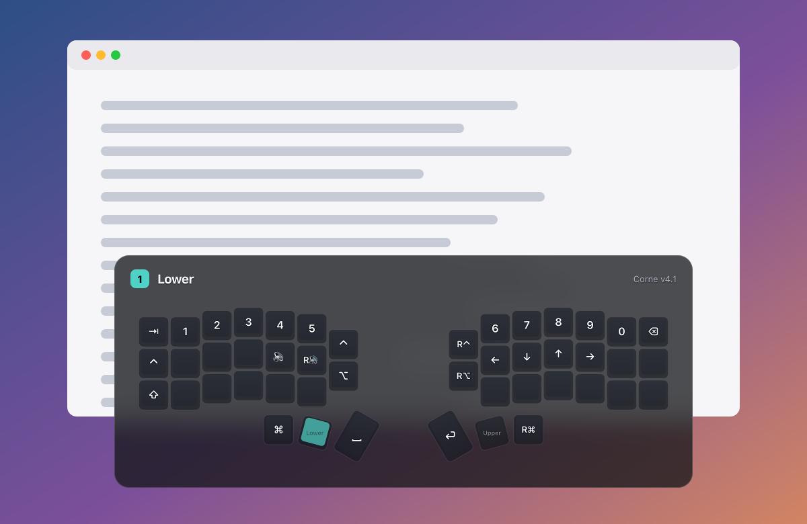

It appears once you've held a layer for 1 second (adjustable), so typing on a layer doesn't make it pop up; hold and wait when you want to look. On macOS the panel blurs whatever is behind it, using the system HUD material. Delay, background tint, size and position are adjustable under **Layer overlay**, along with an **Open at login** switch. While the overlay is on, closing the window keeps Corne Studio running in the background: click the Dock icon to bring it back, or quit with ⌘Q.

How it works: layer keys send nothing to the computer, so while the overlay is on, the app reads the keyboard's switch matrix about 40 times a second in a background thread (`src-tauri/src/overlay.rs`). It then resolves the active layer the way QMK does: the highest active layer that isn't transparent, plus tri-layer. Toggled layers (`TG`/`TO`/`DF`) aren't visible in the matrix, so they don't trigger it.

### Mod-tap, layer-tap and shortcuts
Builders for keys that do two things: tap for `A`, hold for `⌃` (home-row mods); tap for space, hold for layer 1; one key that sends `⌘C`; one-shot modifiers; or any raw 16-bit QMK keycode.

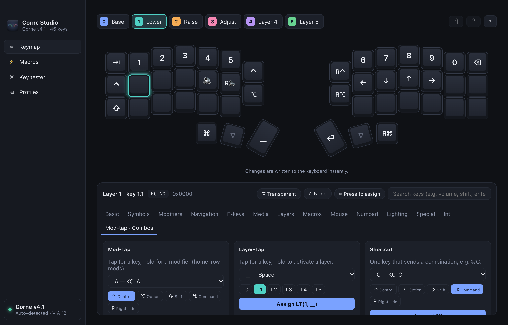

### Macros
Edit the 16 macros stored in the keyboard: type text, tap/hold/release keys, wait. A meter shows how much of the 3287-byte macro memory you've used. Assign `M0…M15` from *Keymap → Macros*.

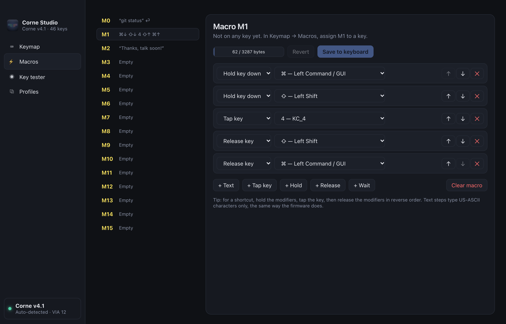

### Key tester
Reads the **switch matrix** straight from the firmware ~40×/second, so every physical switch lights up, including layer keys that send nothing to the computer. It counts how many of the board's switches have registered (handy after swapping switches) and logs what your computer actually receives.

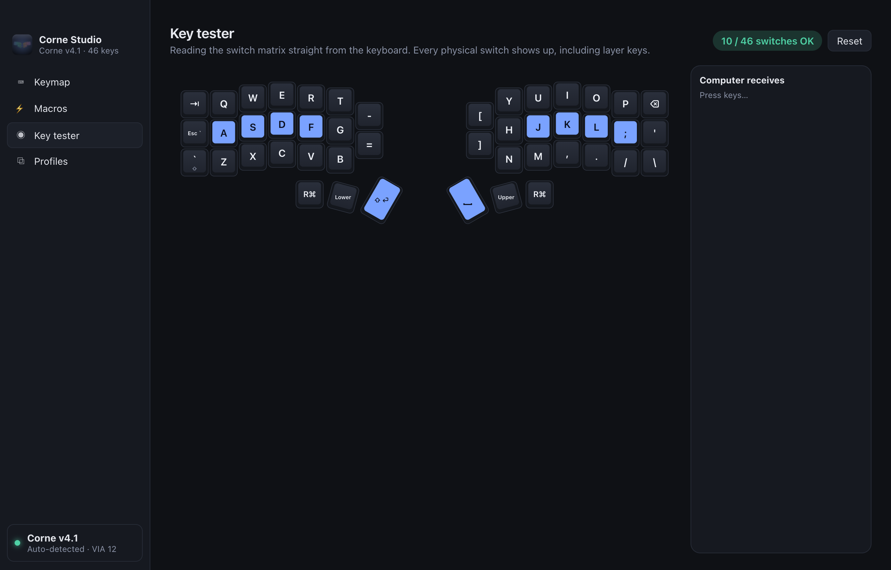

### Profiles
Save complete keymap + macro snapshots, apply them, and import/export them as JSON. The first time the app sees a keyboard model it stores **Original keymap (auto-backup)**, so you can always go back. Profiles carry the board they were made on and can be applied across Corne versions (see below).

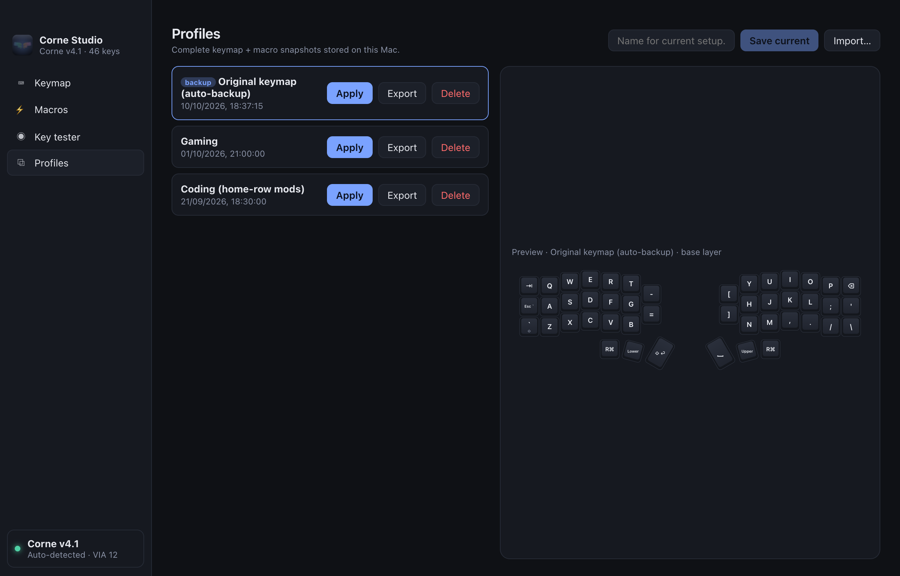

## Supported keyboards

Corne Studio recognises the keyboard from its **USB vendor/product ID**, then picks the matching matrix size and physical layout. Every layout's matrix positions are checked against QMK's own definitions.

| Keyboard | USB ID | Matrix | Drawn as | Recognition |
|---|---|---|---|---|
| **Corne v4.0 / v4.1** (foostan; e.g. [Yushakobo Corne V4 Cherry](https://shop.yushakobo.jp/en/products/8961)) | `4653:0004` | 8 × 7 | 46 keys | Automatic. v4.0 vs v4.1 comes from the USB device release (`0x0400` / `0x0410`). ✅ Tested on a real v4.1 |
| **Corne v4 mini** | `4653:0104` | 8 × 7 | 40 keys | Automatic |
| **Corne v1–v3** (Cherry, Chocolate, LP; Pro Micro / rev1, r2g) | `4653:0001` | 8 × 6 | 42 or 36 keys | Automatic. The 6- or 5-column build can't be told apart electrically, so pick it once in the sidebar |
| **Mechboards CRKBD Pro** | `7171:0003` | 8 × 6 | 42 or 36 keys | Automatic (encoders aren't shown) |
| **Boardsource Unicorne** | `4273:7563` | 8 × 6 | 42 or 36 keys | Automatic |
| **Other Corne clones running VIA** | any | | | You're asked once which board it's based on; the choice is remembered for that USB ID |

> [!NOTE]
> Only the Corne v4.1 has been tested with real hardware so far. The other boards are implemented from their QMK/VIA definitions and checked in simulation. Wireless Cornes running **ZMK** (nice!nano) don't speak VIA, so they aren't supported; use [ZMK Studio](https://zmk.studio) for those.

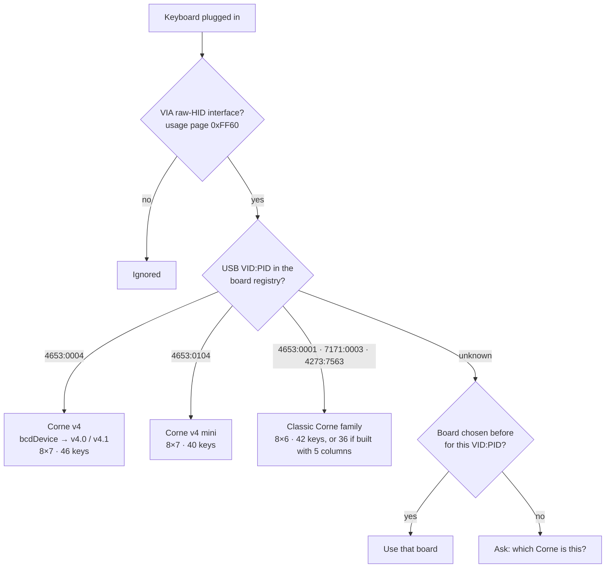

If a keyboard isn't recognised, the app shows the picker below instead of guessing, because reading the keymap with the wrong matrix size would scramble it. With several keyboards plugged in, recognised Cornes come first and a **Keyboard** switcher appears in the sidebar.

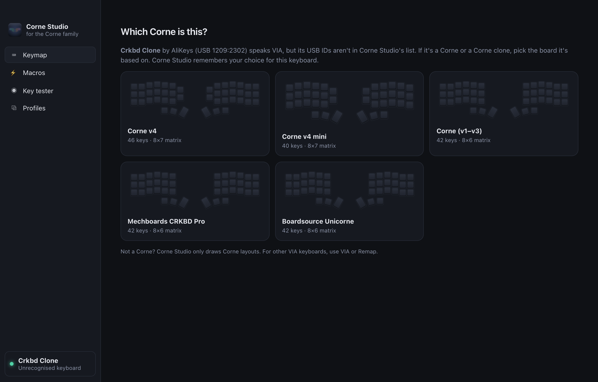

**Profiles across versions:** all Cornes share matrix positions (row *r*, column *c* is the same key on a v3 and a v4), so a profile from one version can be applied to another. Keys the profile doesn't have, such as the v4's two inner keys when applying a v3 profile, keep their current assignment.

## Operating systems

Corne Studio is a macOS and Linux app, built with Tauri (a Rust core plus the system webview). It talks to the keyboard through [hidapi](https://github.com/libusb/hidapi). [GitHub Actions](.github/workflows/build.yml) builds the installers for both whenever a release is tagged. The layer overlay is tested on macOS; on Linux it needs a compositing desktop (GNOME, KDE and most others) for its see-through window.

| OS | Status | Download | Notes |
|---|---|---|---|
| **macOS** (Apple Silicon and Intel, separate downloads) | ✅ Built and tested with a real Corne v4.1 | `.dmg` (~2.3 MB) | The app isn't notarized yet. On first launch, right-click → **Open**, or run `xattr -dr com.apple.quarantine "/Applications/Corne Studio.app"` |
| **Linux** (x64; Ubuntu 22.04+, Debian, Fedora, Arch…) | 🟡 Supported in the code; the first CI build comes with the first release. Not yet tested with a keyboard | `.AppImage`, `.deb`, `.rpm` | Needs a udev rule so non-root users can open the keyboard: install [`linux/99-corne-studio.rules`](linux/99-corne-studio.rules) (instructions are in the file) |

Get the installers from the [**Releases**](https://github.com/Yvorcer/corne-studio/releases) page, or build from source as shown below.

## How it works

The Corne's firmware (QMK with VIA enabled) exposes a second, vendor-specific **raw HID** interface (usage page `0xFF60`, usage `0x61`) next to the normal keyboard interface. Anything that speaks the VIA protocol over it can read and rewrite the keymap the firmware keeps in EEPROM, and the changes apply immediately. That's what Remap and VIA do in the browser, and what Corne Studio does natively.

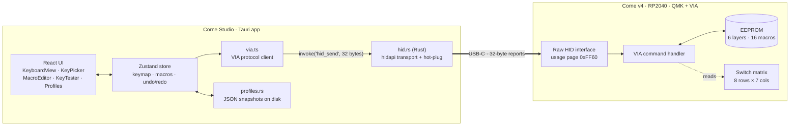

### Changing a key

Each edit is a single 32-byte request/response. The UI updates optimistically and rolls back if the keyboard doesn't confirm.

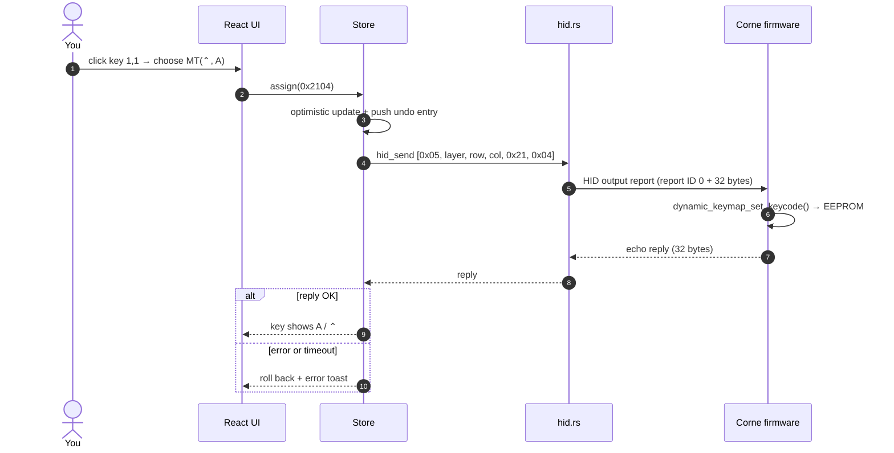

### Mapping physical keys to the matrix

VIA addresses keys by **matrix position**, not by where they sit. The Corne v4 has an 8 × 7 matrix: the left half is rows 0–3 and the right half is rows 4–7, mirrored, so column 0 is the outer pinky column on both sides. Classic Cornes use the same scheme without column 6 (8 × 6), and 5-column builds skip column 0. `src/lib/corneLayout.ts` holds these layouts together with the physical geometry used to draw them; `src/lib/boards.ts` maps USB IDs to boards.

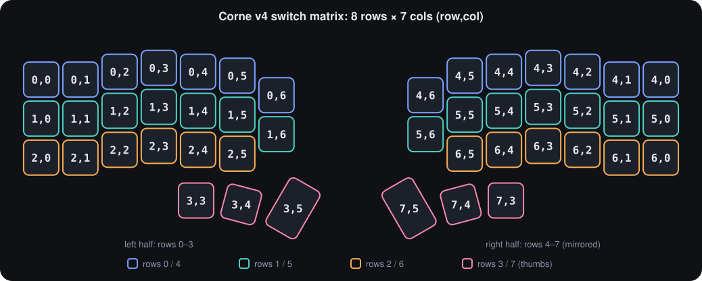

### VIA commands used

| Command | ID | Used for |
|---|---|---|
| `get_protocol_version` | `0x01` | Handshake (this board reports protocol 12) |
| `get_keyboard_value` › `switch_matrix_state` | `0x02 0x03` | Key tester |
| `dynamic_keymap_set_keycode` | `0x05` | Changing one key |
| `dynamic_keymap_macro_get_count` / `_buffer_size` | `0x0C` / `0x0D` | Macro editor limits |
| `dynamic_keymap_macro_get_buffer` / `_set_buffer` | `0x0E` / `0x0F` | Reading/writing macros |
| `dynamic_keymap_get_layer_count` | `0x11` | Number of layers (6) |
| `dynamic_keymap_get_buffer` / `_set_buffer` | `0x12` / `0x13` | Reading the whole keymap, applying profiles (28-byte chunks) |

Keycodes follow QMK's current 16-bit layout (`quantum/keycodes.h`), e.g. `MT(mods, kc) = 0x2000 | mods << 8 | kc`, `LT(layer, kc) = 0x4000 | layer << 8 | kc`, `MO(n) = 0x5220 + n`. Encoding and decoding live in `src/lib/keycodes.ts` and are covered by unit tests.

## Build from source

Requirements on every OS: [Node.js](https://nodejs.org) 22+ and Rust via [rustup](https://rustup.rs). On Linux, also install the WebKit and udev development packages:

```sh
# Debian / Ubuntu
sudo apt install libwebkit2gtk-4.1-dev libappindicator3-dev librsvg2-dev patchelf libudev-dev
```

```sh
git clone https://github.com/Yvorcer/corne-studio.git
cd corne-studio
npm install

npm run tauri dev       # run with hot reload
npm test                # unit tests (keycodes, macros, VIA buffers, board detection)
npm run tauri build     # installers in src-tauri/target/release/bundle/
```

Plug the keyboard in by USB and the app connects on its own; unplugging and replugging is handled too.

> [!NOTE]
> `npm run tauri` goes through `scripts/tauri.mjs`, which puts rustup's `~/.cargo/bin` first on `PATH`, so an older system Rust (e.g. Homebrew's) can't shadow it. Vite is pinned to v6 so it runs on Node 22.8+.

Regenerate the app icon (drawn from the real layout geometry) with `npm run icon`.

## Project layout

| Path | What's there |
|---|---|
| `src-tauri/src/hid.rs` | Finds the `0xFF60` raw-HID interface, sends and receives 32-byte reports, emits hot-plug events |
| `src-tauri/src/profiles.rs` | Profile storage in the OS app-data folder (`~/Library/Application Support/com.yvorcer.cornestudio` on macOS, `~/.local/share/com.yvorcer.cornestudio` on Linux) |
| `src/lib/boards.ts` | Board registry: USB IDs, matrix sizes, layouts, revision detection |
| `src/lib/via.ts` | VIA protocol client: keymap, macros, matrix state |
| `src-tauri/src/overlay.rs` | Layer overlay: background matrix poller, QMK layer resolution, floating click-through window |
| `src/overlay/` · `src/lib/overlaySync.ts` | Overlay window UI, and syncing the keymap and settings to the poller |
| `src/lib/keycodes.ts` | QMK keycode table, encode/decode for MT/LT/MO/TG/OSM/… |
| `src/lib/corneLayout.ts` | Physical geometry of the four Corne layouts (46/40/42/36 keys). Tweak `THUMBS` / `HALF_GAP` here |
| `src/lib/platform.ts` | OS detection for shortcuts and modifier legends |
| `src/lib/macros.ts` | VIA macro buffer format (`SEND_STRING` encoding) |
| `src/state/store.ts` | App state, optimistic writes, undo/redo, profile apply |
| `src/components/` | Keyboard SVG, key picker, macro editor, tester, profiles |
| `scripts/make-icon.ts` | Generates the app icon from `corneLayout.ts` |
| `scripts/tauri.mjs` | Cross-platform wrapper around the Tauri CLI |
| `.github/workflows/build.yml` | CI: type-check + tests on every push; macOS and Linux installers for `v*` tags (published as a release) or manual runs |
| `linux/99-corne-studio.rules` | udev rule for keyboard access on Linux |

## Good to know

- Changes are stored in the keyboard's EEPROM, so they stay with the keyboard on any computer.
- **Applying a profile replaces all layers and macros.** Save the current setup first if you want to keep it.
- Firmware macros can only type US-ASCII text and basic (8-bit) keycodes; the editor enforces this.
- An unrecognised VIA keyboard opens the board picker. If it isn't a Corne, use VIA or Remap for it instead: Corne Studio only knows Corne layouts.

## Credits

[Corne](https://github.com/foostan/crkbd) by foostan · [QMK](https://qmk.fm) · [VIA](https://caniusevia.com) · [Tauri](https://tauri.app)
